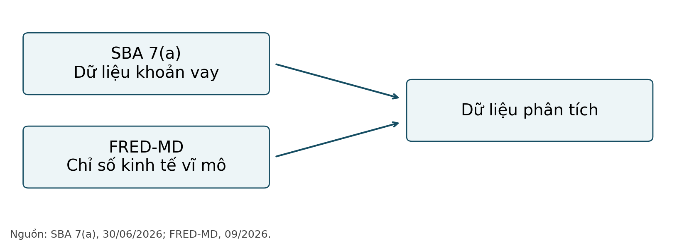
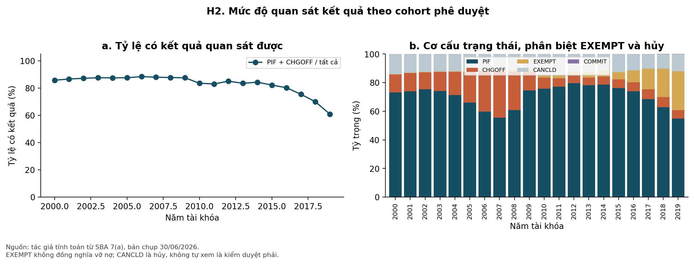
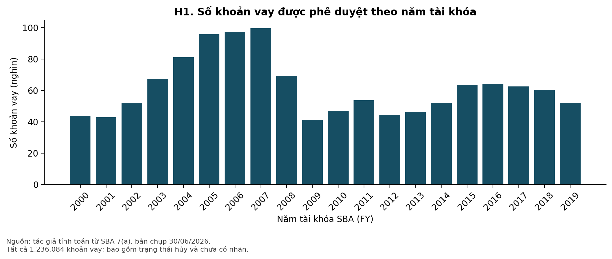
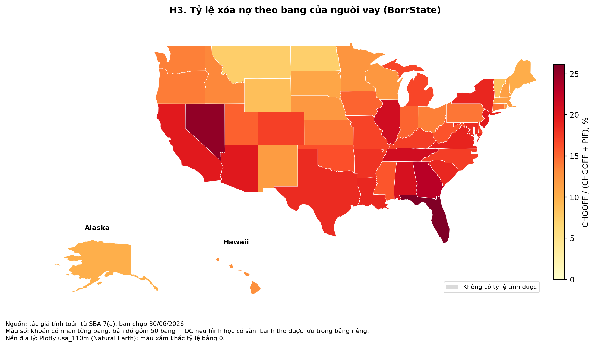
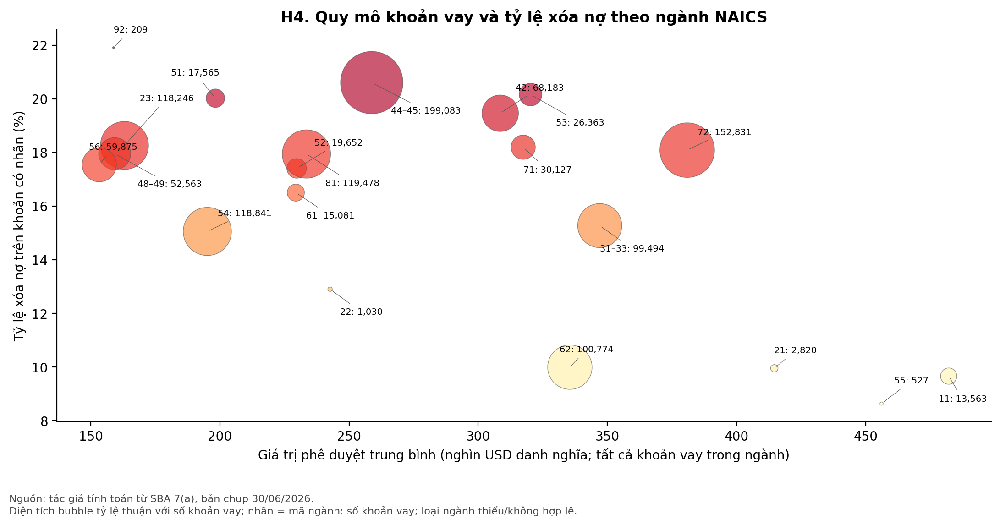
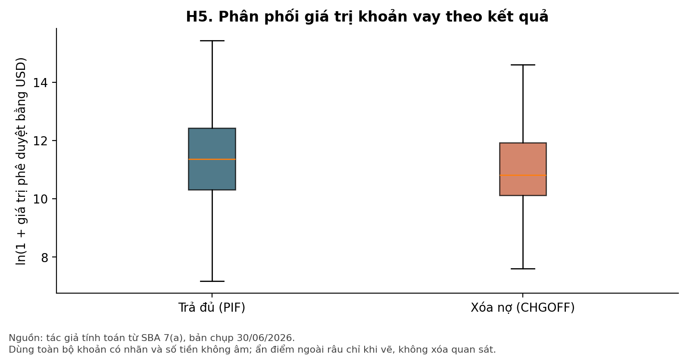
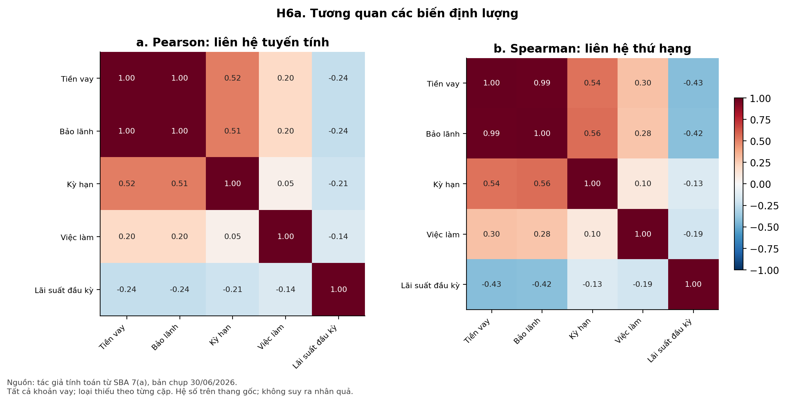
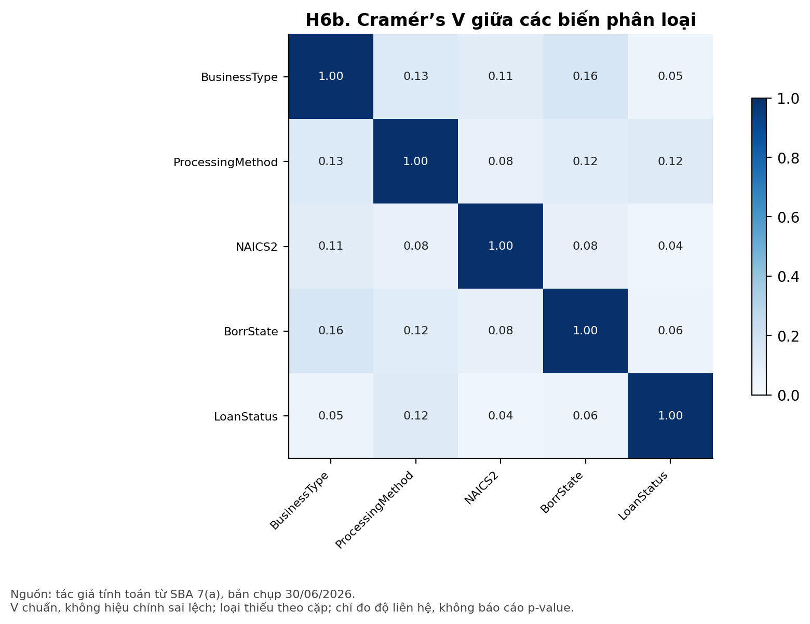

# Chương 2: Mô tả, phân tích tổng quan về dữ liệu

## 2.1. Nguồn gốc và mô tả bộ dữ liệu

### 2.1.1. Nguồn dữ liệu: SBA 7(a) FOIA, bản asof 06/2026, cập nhật hằng quý

SBA (Small Business Administration – Cơ quan Quản lý Doanh nghiệp Nhỏ Hoa Kỳ) cung cấp dữ liệu hành chính cấp khoản vay của chương trình bảo lãnh 7(a). Nghiên cứu sử dụng hai tệp FOIA có trạng thái tại ngày 30/06/2026, lần lượt bao phủ FY2000–FY2009 và FY2010–FY2019 (U.S. Small Business Administration [SBA], 2026a, 2026b). Dữ liệu được công bố theo quý; thời điểm phê duyệt và thời điểm quan sát kết quả vì vậy là hai mốc khác nhau.

Tệp thứ nhất có 690.333 dòng và tệp thứ hai có 545.751 dòng; tổng cộng 1.236.084 dòng, mỗi tệp có 42 cột gốc. Ngày phê duyệt thực tế từ 01/10/1999 đến 30/09/2019, tương ứng 240 tháng. FY2000 bắt đầu tháng 10/1999; việc dùng năm dương lịch thay cho FY sẽ làm lệch nhóm quan sát.

### 2.1.2. Cấu trúc file và nhóm biến: khoản vay, ngân hàng, doanh nghiệp, ngành, địa lý, trạng thái

**Bảng 2.1. Cấu trúc các nhóm biến sử dụng trong phân tích**

| Nhóm | Biến tiêu biểu | Ý nghĩa và lưu ý |
| --- | --- | --- |
| Khoản vay | GrossApproval; TermInMonths | Quy mô (USD danh nghĩa), kỳ hạn (tháng). |
| Bảo lãnh | SBAGuaranteedApproval | Số tiền được SBA bảo lãnh, khác tổng tiền vay. |
| Ngân hàng | BankName | Ngân hàng được gán hiện tại; chưa xác nhận là bên duyệt ban đầu. |
| Doanh nghiệp | BusinessType; BusinessAge | Loại hình pháp lý và nhóm tuổi doanh nghiệp. |
| Ngành, địa lý | NaicsCode; BorrState | Ngành hoạt động và bang của người vay. |
| Thời gian, kết quả | ApprovalDate; LoanStatus | Ngày duyệt và trạng thái tại ngày chụp. |

*Nguồn: tổng hợp từ cấu trúc CSV và từ điển SBA (n.d.). Từ điển chi tiết: Phu_luc_tu_dien_bien.csv.*

Chuẩn hóa ApprovalFY → ApprovalFiscalYear và P I F → PIF trước khi tạo nhãn. LocationID là mã ngân hàng, không phải mã khoản vay. Có 1.414 fingerprint hàng lặp; do thiếu khóa khoản vay, giữ nguyên mọi dòng. Bản mới không có Subprogram; phân tích dùng ProcessingMethod.

*Hình 2.1. Sơ đồ nguồn và liên kết dữ liệu. Nguồn: tác giả xây dựng từ cấu trúc SBA và FRED-MD.*

<!-- Ngắt trang bản Word -->

### 2.1.3. Biến mục tiêu (LoanStatus: CHGOFF/PIF) và các biến rò rỉ

Trong nghiên cứu này, “vỡ nợ” được định nghĩa vận hành bằng trạng thái xóa nợ CHGOFF, thay vì mọi biểu hiện chậm trả. Biến target nhận 1 khi CHGOFF và 0 khi PIF (trả đủ); EXEMPT, CANCLD và COMMIT không được gán vào lớp trả đủ. is_resolved đánh dấu hai trạng thái có nhãn và không đồng nghĩa mọi trạng thái kết thúc theo nghĩa hành chính đều đã được đưa vào bài toán phân loại (SBA, n.d.).

LoanStatus tạo nhãn nên không được dùng làm đặc trưng. PaidInFullDate, ChargeOffDate và GrossChargeOffAmount phản ánh kết quả sau khi cho vay; FirstDisbursementDate và SoldSecMrktInd cũng không được mặc nhiên coi là thông tin đã biết khi phê duyệt. BankName mô tả ngân hàng đang được gán khoản vay, nên cần kiểm chứng lịch sử trước khi dùng cho dự báo tại thời điểm duyệt. Trong Chương 2, các trường này chỉ phục vụ mô tả, không tạo tập đặc trưng mô hình.

### 2.1.4. Biến vĩ mô bổ sung từ FRED-MD (ghép theo tháng phê duyệt)

FRED-MD là cơ sở dữ liệu vĩ mô theo tháng được thiết kế để hỗ trợ nghiên cứu thực nghiệm có thể tái lập (McCracken & Ng, 2016). Tệp Fred.csv hiện có khớp SHA-256 với bản chính thức tháng 09/2026: 126 biến và 812 quan sát từ 01/1959 đến 08/2026. Như vậy, 09/2026 là phiên bản phát hành, không phải tháng quan sát cuối (Federal Reserve Bank of St. Louis, 2026).

**Bảng 2.2. Sáu chỉ tiêu vĩ mô nền và cách biểu diễn**

| Chuỗi gốc | Nội dung | Biểu diễn khi ghép |
| --- | --- | --- |
| UNRATE | Tỷ lệ thất nghiệp | Mức, %; trễ một tháng. |
| FEDFUNDS | Lãi suất quỹ liên bang | Mức, %; trễ một tháng. |
| T10YFFM | Chênh lệch lãi suất 10 năm – quỹ liên bang | Mức, điểm %; trễ một tháng. |
| CPIAUCSL | Chỉ số giá tiêu dùng | Tăng trưởng so cùng kỳ, %. |
| INDPRO | Chỉ số sản xuất công nghiệp | Tăng trưởng so cùng kỳ, %. |
| BUSLOANS | Dư nợ cho vay thương mại, công nghiệp | Tăng trưởng so cùng kỳ, %. |

*Nguồn: FRED-MD (Federal Reserve Bank of St. Louis, 2026); cách biến đổi do tác giả quy định cho bài toán.*

Dòng Transform: được tách thành bảng mã biến đổi, không được tính là quan sát. CPI, sản xuất công nghiệp và dư nợ được đổi sang 100 × (Xₜ/Xₜ₋₁₂ − 1) trước khi cắt giai đoạn. Sau đó, sáu chỉ tiêu được dịch một tháng và liên kết nhiều–một với approval_month. Kiểm tra cho thấy đủ 240 tháng, không thiếu giá trị trong cửa sổ ghép và số khoản vay không tăng sau liên kết.

Độ trễ này giảm khả năng dùng số liệu cùng tháng chưa công bố, nhưng không tái lập đầy đủ tập thông tin ngân hàng từng có. Lịch công bố khác nhau và phiên bản 2026 chứa số liệu lịch sử đã điều chỉnh. Do đó, phân tích mang tính hồi cứu; không thể tuyên bố đã loại hết sai lệch nhìn trước chỉ bằng lag một tháng.

<!-- Ngắt trang bản Word -->

## 2.2. Thách thức của bộ dữ liệu

### 2.2.1. Giá trị thiếu

Giá trị thiếu tập trung không đồng đều giữa các biến. Bảng 2.3 cho thấy cần phân biệt thiếu thông tin nền với thiếu có điều kiện theo trạng thái; chẳng hạn, ngày xóa nợ thường không áp dụng cho khoản không bị xóa nợ. Bởi vậy, không thể đánh giá chất lượng dữ liệu chỉ bằng tỷ lệ ô trống chung hoặc bù tất cả ô trống bằng cùng một quy tắc.

**Bảng 2.3. Một số trường có dữ liệu thiếu đáng chú ý**

| Biến | Số thiếu | Tỷ lệ trên toàn mẫu |
| --- | --- | --- |
| FranchiseCode | 1.148.897 | 92,95% |
| ChargeOffDate | 1.057.595 | 85,56% |
| SoldSecMrktInd | 966.624 | 78,20% |
| InitialInterestRate | 653.700 | 52,88% |
| NaicsCode | 19.779 | 1,60% |

*Nguồn: tác giả tính toán từ SBA 7(a), bản chụp ngày 30/06/2026.*

InitialInterestRate thiếu hoàn toàn trong FY2000–FY2008, trong khi FY2010–FY2019 có dữ liệu đầy đủ cho biến này. Thiếu dữ liệu vì thế gắn với thời gian quan sát; bù một giá trị trung bình chung có thể che khuất sự thay đổi phạm vi thu thập. FranchiseCode trống cũng không tự chứng minh doanh nghiệp không nhượng quyền. BusinessAge còn có nhóm Unanswered; đây là thiếu thông tin về mặt nội dung dù không phải ô rỗng. Chưa có căn cứ để khẳng định cơ chế MCAR, MAR hoặc MNAR.

### 2.2.2. Ngoại lai: khoản vay rất lớn, kỳ hạn bất thường

Quy tắc IQR đánh dấu quan sát ngoài [Q1 − 1,5IQR; Q3 + 1,5IQR]. Đây là tiêu chí rà soát phân phối, không phải quy tắc xác nhận sai dữ liệu. Tiền vay có độ lệch phải và quy mô kinh tế khác nhau, nên loại tự động các khoản lớn sẽ làm thay đổi đối tượng nghiên cứu.

**Bảng 2.4. Quan sát cần rà soát theo quy tắc IQR**

| Biến | Ngưỡng trên | Số vượt khoảng IQR | Giá trị lớn nhất |
| --- | --- | --- | --- |
| GrossApproval | 605.450,0 | 142.931 | 5.000.000 |
| TermInMonths | 210,0 | 157.778 | 847 |
| JobsSupported | 23,5 | 108.562 | 9.500 |

*Nguồn: tác giả tính toán từ SBA 7(a), bản chụp ngày 30/06/2026.*

Kỳ hạn lớn nhất là 847 tháng; có 1.138 khoản ghi 0 tháng và 10.314 khoản trên 300 tháng. Những giá trị này cần đối chiếu hồ sơ, không tự kết luận vi phạm quy định. JobsSupported có 223.310 quan sát bằng 0 và cực đại 9.500. SBA (n.d.) xác định đây là ước lượng việc làm tạo mới cộng duy trì do bên cho vay tự báo cáo, chưa được SBA kiểm chứng; không thể diễn giải thành số việc làm thực tế đã tạo ra. EDA giữ nguyên dữ liệu và dùng log1p cho hình phân phối tiền vay.

<!-- Ngắt trang bản Word -->

### 2.2.3. Mất cân bằng lớp (xóa nợ là thiểu số)

Tập có nhãn gồm 854.943 khoản trả đủ và 178.504 khoản xóa nợ, tương ứng 17,27% xóa nợ. Tỷ số số khoản trả đủ trên xóa nợ là 4,79 lần. Đây là bằng chứng về mất cân bằng lớp; việc đánh giá mô hình sau này cần xem xét khả năng phát hiện lớp xóa nợ bên cạnh độ chính xác chung. Chương này không tái lấy mẫu hoặc thay đổi tỷ trọng lớp.

### 2.2.4. Khoản vay chưa có kết quả (kiểm duyệt phải) và rò rỉ dữ liệu

Ngoài tập có nhãn, dữ liệu chứa 149.020 khoản CANCLD (hủy), 53.573 khoản EXEMPT và 44 khoản COMMIT (chưa giải ngân). Theo SBA (n.d.), EXEMPT là khoản đã giải ngân nhưng chưa hủy, trả đủ hoặc xóa nợ, với một số thông tin được miễn công bố. Vì vậy, không đồng nhất trạng thái hủy với việc đang tiếp tục theo dõi kết quả.

*Hình 2.2 (H2). Tỷ lệ có kết quả và cơ cấu trạng thái theo FY. Mẫu số: toàn bộ khoản vay từng FY.*

Tỷ lệ có nhãn giảm từ 85,78% ở FY2000 xuống 60,89% ở FY2019; riêng tỷ trọng EXEMPT của FY2019 đạt 27,10%. Hình 2.2 cho thấy thời gian theo dõi giữa các cohort không tương đương. Tỷ lệ xóa nợ trên các khoản đã có kết quả vì thế có thể bị chọn lọc theo thời gian kết thúc; hướng và mức thiên lệch không thể xác định chỉ từ đồ thị. Đây là vấn đề quan sát chưa đầy đủ cần được phân biệt trong phân tích thời gian đến sự kiện (Kaplan & Meier, 1958).

### 2.2.5. Chỉ có khoản vay đã được duyệt (thiên lệch chọn mẫu) và thông tin định danh cần loại bỏ

Mẫu không bao gồm hồ sơ bị từ chối, nên kết quả chỉ mô tả khoản vay đã được SBA phê duyệt; không suy rộng trực tiếp sang mọi doanh nghiệp xin vay. Tên, địa chỉ, thành phố, ZIP của người vay và mã định danh không được đưa vào dữ liệu xử lý hoặc đầu ra notebook. Bang được giữ ở mức tổng hợp. CSV gốc được lưu riêng để tái lập và không dùng làm bảng minh họa trong báo cáo.

<!-- Ngắt trang bản Word -->

## 2.3. Khám phá dữ liệu

### 2.3.1. Phân tích mô tả: biến định lượng (GrossApproval, TermInMonths, JobsSupported...); biến định tính (BusinessType, Subprogram, ngành, bang)

Bảng 2.5 mô tả toàn bộ khoản vay với số quan sát hợp lệ theo từng biến; các khoản chưa có nhãn vẫn được giữ. Bản 30/06/2026 không có Subprogram; thống kê phương thức cho vay dùng ProcessingMethod, không tự tạo cột Subprogram. Tiền vay là USD danh nghĩa, chưa điều chỉnh lạm phát; biến động quy mô tiền tệ không được tự diễn giải thành thay đổi sức mua tương ứng.

**Bảng 2.5. Thống kê mô tả các biến định lượng chính**

| Biến | Trung bình | ĐLC | Trung vị | Q1–Q3 |
| --- | --- | --- | --- | --- |
| Tiền vay (USD) | 266.432,11 | 508.232,14 | 89.500 | 29.700–260.000 |
| Bảo lãnh (USD) | 195.042,33 | 388.347,38 | 50.000 | 15.000–186.000 |
| Kỳ hạn (tháng) | 107,81 | 75,28 | 84 | 60–120 |
| Việc làm (ước lượng) | 9,14 | 24,34 | 4 | 1–10 |

*Nguồn: tác giả tính toán từ SBA 7(a), bản chụp ngày 30/06/2026. ĐLC: độ lệch chuẩn mẫu. N = 1.236.084, riêng JobsSupported có N = 1.236.082.*

GrossApproval có trung bình 266.432,11 USD, cao hơn trung vị 89.500 USD; độ lệch 4,42 phù hợp với đuôi phải dài. Khoảng tứ phân vị từ 29.700 đến 260.000 USD thể hiện sự không đồng nhất đáng kể về quy mô tài trợ. Vì vậy, trung vị và tứ phân vị bổ sung thông tin cần thiết cho trung bình.

Kỳ hạn trung vị là 84 tháng, trong khi việc làm ước lượng trung vị là 4. Lãi suất đầu kỳ chỉ có 582.384 quan sát hợp lệ; số trung bình 6,53 phần trăm của biến này không đại diện đồng đều cho toàn bộ giai đoạn. Các thống kê tần số chi tiết và nhóm thiếu được lưu riêng để tránh đánh đồng mẫu số giữa các bảng.

Về loại hình pháp lý, CORPORATION chiếm 79,33%, INDIVIDUAL chiếm 18,24% và PARTNERSHIP chiếm 2,38% toàn mẫu. Nhãn được giữ theo dữ liệu gốc, tránh quy đổi tùy ý sang loại hình pháp lý của Việt Nam. Với NAICS, các dải 31–33, 44–45 và 48–49 được gộp theo nhóm ngành; 19.779 khoản thiếu hoặc không có mã hợp lệ không được gán ngành suy đoán.

**Bảng 2.6. Tỷ lệ xóa nợ theo loại hình doanh nghiệp**

| Nhóm | Có nhãn | Xóa nợ | Tỷ lệ | KTC Wilson 95% |
| --- | --- | --- | --- | --- |
| CORPORATION | 812.488 | 132.542 | 16,31% | 16,23%–16,39% |
| INDIVIDUAL | 195.651 | 42.503 | 21,72% | 21,54%–21,91% |
| PARTNERSHIP | 24.850 | 3.272 | 13,17% | 12,75%–13,59% |

*Nguồn: tác giả tính toán từ SBA 7(a), bản chụp ngày 30/06/2026. Mẫu số là PIF + CHGOFF trong từng nhóm; nhóm thiếu được giữ trong bảng đầy đủ B9.*

INDIVIDUAL có tỷ lệ xóa nợ quan sát cao hơn hai nhóm còn lại, nhưng chênh lệch này chưa kiểm soát cơ cấu ngành, thời gian phê duyệt hoặc độ dài theo dõi. Khoảng Wilson (Wilson, 1927) chỉ mô tả độ bất định nhị thức với giả định độc lập; chưa điều chỉnh phụ thuộc theo tháng hoặc ngân hàng, và không phải bằng chứng nhân quả.

<!-- Ngắt trang bản Word -->

### 2.3.2. Trực quan hóa tổng quan: xu hướng theo năm, bản đồ theo bang, bubble theo ngành (mỗi bubble ghi số), violin/box

*Hình 2.3 (H1). Số khoản vay phê duyệt theo năm tài khóa. Mẫu: tất cả khoản vay trong phạm vi nghiên cứu.*

Số khoản vay đạt cao nhất ở FY2007, với 99.606 khoản, sau đó giảm xuống 41.288 ở FY2009. Hình 2.3 phản ánh thay đổi số lượng phê duyệt; riêng diễn biến này chưa đủ tách tác động của nhu cầu tín dụng, chính sách chương trình và điều kiện kinh tế. Phân tích chuỗi thời gian thuộc phần nghiên cứu tiếp theo.

*Hình 2.4 (H3). Bản đồ tỷ lệ xóa nợ theo BorrState. Tỷ lệ chỉ tính trên khoản có nhãn; hình học nền từ Plotly/Natural Earth.*

Florida có tỷ lệ xóa nợ 26,12% trên 52.090 khoản có nhãn, so với 19,75% trên 135.427 khoản tại California. Màu bản đồ thể hiện tỷ lệ, không phải số lượng khoản vay hoặc mức tổn thất tiền tệ. Lãnh thổ và mã địa lý ngoài lớp bản đồ được lưu ở bảng riêng; không gán tỷ lệ 0 cho địa bàn không có dữ liệu tính được.

<!-- Ngắt trang bản Word -->

Trực quan hóa tổng quan (tiếp theo)

*Hình 2.5 (H4). Quy mô, tỷ lệ xóa nợ và số khoản vay theo ngành. Mỗi bubble ghi mã ngành và số khoản vay.*

Bán lẻ (44–45) có 199.083 khoản vay và tỷ lệ xóa nợ 20,60% trên khoản có nhãn; y tế và trợ giúp xã hội (62) có 100.774 khoản với tỷ lệ 9,99%. Trục hoành dùng quy mô trung bình của tất cả khoản vay trong ngành, còn trục tung dùng tập có nhãn. Sự khác biệt mẫu số được giữ minh bạch để tránh diễn giải sai vị trí các nhóm.

Nhóm hành chính công (92) có tỷ lệ 21,91% nhưng chỉ 178 khoản có nhãn; khoảng Wilson từ 16,46% đến 28,54%. Vì vậy, không nên xếp hạng ngành chỉ theo tỷ lệ điểm mà bỏ qua quy mô và độ bất định. Mã NAICS được diễn giải ở cấp ngành rộng; chưa thực hiện quy đổi đầy đủ giữa mọi phiên bản hệ thống ngành qua thời gian.

*Hình 2.6 (H5). Boxplot ln(1 + GrossApproval) theo nhãn. Dùng toàn bộ khoản có nhãn, ẩn điểm ngoài râu khi vẽ.*

Phép log1p làm giảm chênh lệch thị giác giữa các khoản nhỏ và lớn; không thay đổi dữ liệu gốc hoặc tự loại ngoại lai. Hình 2.6 cho phép so sánh vị trí và độ phân tán giữa hai nhóm, nhưng mức độ chồng lấn của phân phối cần được giữ trong diễn giải. Không kết luận tiền vay gây xóa nợ hoặc thay thế kiểm định nhóm bằng quan sát hình.

<!-- Ngắt trang bản Word -->

### 2.3.3. Phân tích tương quan: heatmap, Pearson vs Spearman, Cramér's V, tỷ lệ xóa nợ theo nhóm

Pearson đo liên hệ tuyến tính trên thang gốc, còn Spearman đo liên hệ theo thứ hạng, phù hợp để đối chiếu khi phân phối lệch (Pearson, 1895; Spearman, 1904). Thiếu được loại theo từng cặp; các cặp có lãi suất chỉ dùng cửa sổ dữ liệu có thông tin. Không coi mã ngành hoặc mã bang là đại lượng liên tục.

*Hình 2.7 (H6a). Pearson và Spearman giữa các biến định lượng; số quan sát theo cặp được lưu ở B15.*

GrossApproval và SBAGuaranteedApproval có Pearson 0,995; đây là liên hệ phù hợp với cấu trúc phần bảo lãnh thuộc khoản vay. Với JobsSupported, Pearson là 0,199 và Spearman là 0,296. Sự khác nhau giữa hai hệ số cho thấy thang đo và các giá trị lớn ảnh hưởng đến cách mô tả liên hệ; không tự xác định nguyên nhân của khác biệt.

*Hình 2.8 (H6b). Cramér’s V chuẩn giữa các biến phân loại. LoanStatus gồm cả năm trạng thái, không phải riêng target nhị phân.*

Cramér’s V nằm trong [0; 1] và không biểu diễn chiều liên hệ (Cramér, 1946). ProcessingMethod–LoanStatus có V = 0,124, trong khi BusinessType–LoanStatus có V = 0,055. Không dùng ngưỡng cứng hoặc p-value để gọi các liên hệ này là quyết định rủi ro. Các bảng tỷ lệ nhóm bổ sung hướng khác biệt, nhưng vẫn chịu giới hạn cohort, chọn mẫu và quan sát chưa đầy đủ.

<!-- Ngắt trang bản Word -->

## Tài liệu tham khảo

Cramér, H. (1946). *Mathematical methods of statistics (PMS-9)*. Princeton University Press. https://doi.org/10.1515/9781400883868

Federal Reserve Bank of St. Louis. (2026). *FRED-MD: Monthly database for macroeconomic research* (September 2026 vintage) [Data set]. https://www.stlouisfed.org/-/media/project/frbstl/stlouisfed/research/fred-md/monthly/2026-09-md.csv

Kaplan, E. L., & Meier, P. (1958). Nonparametric estimation from incomplete observations. *Journal of the American Statistical Association, 53*(282), 457–481. https://doi.org/10.1080/01621459.1958.10501452

McCracken, M. W., & Ng, S. (2016). FRED-MD: A monthly database for macroeconomic research. *Journal of Business & Economic Statistics, 34*(4), 574–589. https://doi.org/10.1080/07350015.2015.1086655

Pearson, K. (1895). Note on regression and inheritance in the case of two parents. *Proceedings of the Royal Society of London, 58*, 240–242. https://doi.org/10.1098/rspl.1895.0041

Spearman, C. (1904). The proof and measurement of association between two things. *The American Journal of Psychology, 15*(1), 72–101. https://doi.org/10.2307/1412159

U.S. Small Business Administration. (n.d.). *7(a) and 504 FOIA data dictionary* [Data dictionary]. Retrieved October 20, 2026, from https://data.sba.gov/sites/default/files/uploaded_resources/7a_504_foia_data_dictionary.xlsx

U.S. Small Business Administration. (2026a). *FOIA 7(a), FY2000–FY2009, as of June 30, 2026* [Data set]. https://data.sba.gov/sites/default/files/uploaded_resources/FOIA_7a_FY2000_FY2009_asof_260630.csv

U.S. Small Business Administration. (2026b). *FOIA 7(a), FY2010–FY2019, as of June 30, 2026* [Data set]. https://data.sba.gov/sites/default/files/uploaded_resources/FOIA_7a_FY2010_FY2019_asof_260630.csv

Wilson, E. B. (1927). Probable inference, the law of succession, and statistical inference. *Journal of the American Statistical Association, 22*(158), 209–212. https://doi.org/10.1080/01621459.1927.10502953
